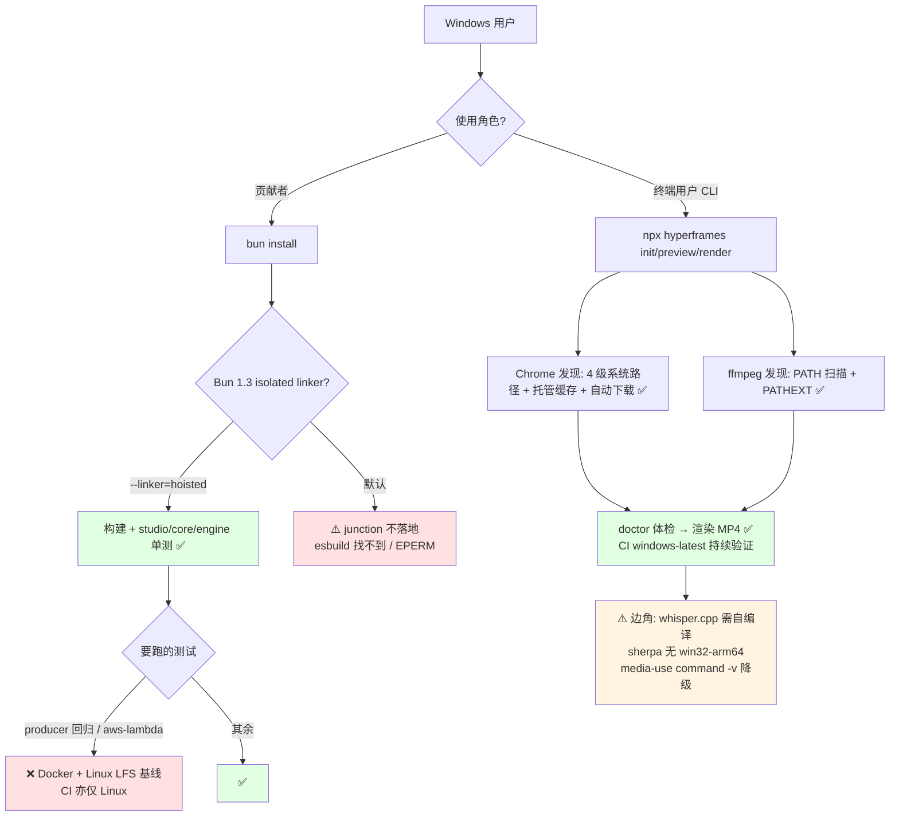

# HyperFrames - Windows 兼容性分析

> 生成时间: 2026-10-11
> 分析方式: windows-compat-checker.sh 自动扫描 + 源码逐项验证（平台守卫、浏览器/ffmpeg 发现、子进程、CI 工作流）

## 总体评估

| 指标 | 结果 |
|------|------|
| 总体评级 | ⚠️ 部分兼容（良好）— 终端用户 CLI 实际接近 ✅；贡献者本地开发有 1 个高危注意事项 |
| 高危问题 | 1 |
| 中危问题 | 4 |
| 低危问题 | 3 |
| 已正确适配项 | 10 组（约 50 处显式 win32 分支） |

### 评级说明

| 等级 | 含义 |
|------|------|
| ✅ 完全兼容 | 项目可在 Windows 上正常构建和运行 |
| ⚠️ 部分兼容 | 可构建但部分功能不可用，需少量修复 |
| ❌ 不兼容 | 无法在 Windows 上构建或核心功能不可用 |

**结论先行**：该项目对 Windows 的适配远超一般开源视频渲染框架 —— ffmpeg/Chrome 发现、子进程、symlink、崩溃码翻译均有专门 win32 分支，且 `windows-render.yml` 在 windows-latest 上跑真实渲染冒烟（init → render → ffprobe 验证 MP4）+ 4 条单测 lane，`ci.yml` 亦含 Windows matrix。主要风险集中在 **Bun 1.3 Windows linker**（本地安装需 `--linker=hoisted`）与**少量 POSIX-only 辅助脚本**。

> 自动扫描的更正：脚本曾把 `windows-render.yml` 标记为"排除 Windows"，源码验证为**误判** —— 该工作流实际包含 `render-windows`（L92-396）与 `test-windows-lane`（L410-525）两个 windows-latest job；跳过的仅是 producer 回归与 aws-lambda 测试（均带 `if:` 与理由注释）。

## 1. 构建系统兼容性

### 1.1 package.json Scripts（根）

| Script | 命令 | 问题 | 严重程度 |
|--------|------|------|----------|
| `test:skills` | `HYPERFRAMES_MEDIA_HOME_REQUIRED=1 node …` | POSIX env 前缀语法；`bun run` 内置 shell 可跨平台执行，但 npm/yarn 用户在 cmd/PowerShell 下失败 | 中 |
| `prepare` | `test -d .git && lefthook install \|\| true` | POSIX `test`/`&&`/`||`；同上，依赖 bun shell | 低 |
| `upload:docs-images` | `bash scripts/upload-docs-images.sh` | 显式依赖 bash，Windows 需 Git Bash | 低 |

### 1.2 生命周期 Hooks

| Hook | 命令 | 问题 | 严重程度 |
|--------|------|------|----------|
| `prepare` | `test -d .git && lefthook install \|\| true` | 经 `bun install` 触发时由 bun shell 执行，可用；经 npm 触发则失败 | 低 |

### 1.3 构建工具链

| 工具 | Windows 支持 | 说明 |
|------|-------------|------|
| bun（workspace 操作） | ⚠️ | CI 在 Windows 强制 `bun install --linker=hoisted` 绕开 Bun 1.3.x isolated linker 的 junction 不落地问题（oven-sh/bun#23615、#18354、#10146：`Cannot find package 'esbuild'` / EPERM stat）。**本地开发者照 CONTRIBUTING.md 直接 `bun install` 可能踩坑** —— 根 package.json 无 engines/packageManager 字段锁版本（高危项） |
| tsup / esbuild / vite | ✅ | 常规跨平台构建 |
| oxlint / oxfmt | ✅ | |
| Docker（producer 测试 / gcp-cloud-run 镜像） | ❌ | Dockerfile 假定 Linux 容器（node:22-bookworm-slim），Windows 原生不可用；WSL2 + Docker Desktop 可行 |
| FFmpeg | ✅ | CLI 自带发现逻辑 + CI 有专门安装 action（见 §7） |

## 2. 源代码兼容性

### 2.1 child_process 调用

整体健康：ffmpeg 用 `spawn(path, args, { windowsHide: true })` 直接数组参数、无 shell、无 POSIX 特有参数（`packages/engine/src/utils/runFfmpeg.ts:154-162`；双进程管道 `runFfmpegPipeline` 同样安全，`:209-245`）。

| 文件 | 行号 | 调用方式 | 问题 |
|------|------|----------|------|
| `packages/cli/src/media-use/lib/local-run.mjs` | 22, 26 | `execFileSync("command", ["-v", bin], {shell:true})` | `command -v` 为 POSIX 内建，Windows 下不可用（该路径静默降级到推荐提示） |
| `skills/pr-to-video/scripts/preflight.mjs` | 14 | `shell: process.platform === "win32"` | win32 下走 cmd 语义解析，少数 shell 用法（有测试覆盖） |

### 2.2 平台相关代码（已正确适配，摘录）

| 文件 | 行号 | 问题类型 | 处理方式 |
|------|------|----------|----------|
| `packages/parsers/src/ffBinaries.ts` | 45, 57, 63-74, 104, 134-139 | ffmpeg 发现 | win32 用 existsSync 替代 X_OK、额外搜 cwd、PATHEXT 扩展枚举、`.exe` 后缀、Node 原生 PATH 扫描替代 `where.exe`（规避控制台代码页 mojibake）、过滤 `.cmd/.bat` 假命中 |
| `packages/cli/src/browser/manager.ts` | 271-299, 337-344, 350-379, 461-465, 800-834 | Chrome 发现 | 四级系统路径（ProgramW6432/PROGRAMFILES/X86/LOCALAPPDATA）→ env 覆盖 → 托管缓存按 buildId+platform 匹配 → `where`/`which` → 下载 pinned chrome-headless-shell（`win32/x64 → chrome-headless-shell-win64/.exe`） |
| `packages/studio/vite.browser.ts` | 19-47, 70-128 | Studio 侧 Chrome 发现 | 同源逻辑；要求版本 ≥134 |
| `packages/cli/src/browser/windowsCrash.ts` | 30-50 | 崩溃翻译 | STATUS_STACK_BUFFER_OVERRUN (0xC0000409) 检测 + `HYPERFRAMES_BROWSER_PATH` 补救提示 |
| `packages/engine/src/utils/runFfmpeg.ts` | 84-107 | 错误翻译 | 0xC0000135（DLL 缺失）/ 0xC000007B（架构错误）翻译为可操作提示 |
| `packages/engine/src/utils/managedChildProcess.ts` | 141-163 | 信号 | SIGTERM → 2s 宽限 → SIGKILL 升级（Node 在 Windows 映射为 TerminateProcess，语义正确） |
| `packages/cli/src/utils/npxCommand.ts` | 9-18 | npx shim | win32 下 `.cmd` shim 经 `cmd.exe /d /s /c` 调用 |
| `packages/cli/src/browser/preflight.ts` | 386-396 | UNC 路径 | 网络路径警告 |
| `packages/engine/src/utils/processRss.ts` | 91-98 | RSS 采样 | win32 用 tasklist CSV |
| `packages/cli/src/registry/installer.ts` | 333-335 | 路径大小写 | win32/darwin NFC+小写别名防冲突 |
| `packages/studio/vite.adapter.ts` | 106 | 非法字符 | win32 拒绝含 `:` 的 projectId |

### 2.3 Unix 专用 API

| API | 文件 | 行号 | Windows 替代方案 |
|-----|------|------|-----------------|
| symlink（EPERM/EACCES 降级） | `packages/producer/src/services/render/shared.ts` | 551-597, 607-619 | 已内置降级链：symlink 失败 → Windows junction → cpSync 整目录拷贝（一次性日志）+ EEXIST 脏目录自愈 |
| `ldd` 共享库探测 | `packages/cli/src/browser/preflight.ts` | 200 | Linux-only 检查，对 Windows 原生无影响 |

## 3. 文件系统兼容性

### 3.1 路径处理

代码整体统一使用 Node path API；自动扫描未发现硬编码 POSIX 路径分隔符的高危项。已知的针对性处理见上表（UNC 警告、大小写别名、`:` 拒绝）。

### 3.2 符号链接

| 文件 | 行号 | Windows 处理 | 说明 |
|------|------|-------------|------|
| `packages/producer/src/services/render/shared.ts` | 551-597 | ✅ junction / 拷贝降级 | 渲染 staging 目录的跨平台落地 |
| `packages/sdk/src/adapters/fs.test.ts` | 44-92 | ✅ skipIf | 30+ 测试文件用 `it.skipIf(process.platform === "win32")` 显式跳过 symlink/权限用例 |
| `npx skills add`（技能安装） | — | ✅ 见 CLAUDE.md 警告 | 在 HyperFrames checkout 内 `--all` 安装会经 OpenClaw target 删除 `skills/<name>` —— 与平台无关的已知陷阱 |

## 4. Shell 和脚本兼容性

### 4.1 Shell 脚本

仓库 20 个 `.sh` 脚本（examples/aws-lambda、examples/gcp-cloud-run、packages/producer 的 de-* 套件、scripts/ci、skills/embedded-captions 等），**均无对应 .ps1/.cmd**。定位分类：

| 类别 | 脚本 | Windows 影响 |
|------|------|--------------|
| 云部署/冒烟（目标 Linux） | examples/aws-lambda/scripts/*、examples/gcp-cloud-run/scripts/smoke.sh | 无影响（部署目标即 Linux） |
| producer 质量门禁 | packages/producer/de-canary-suite.sh、de-gatecheck.sh | 本地 Windows 不可用（依赖 Docker + LFS golden 基线，CI 亦仅 Linux） |
| 仓库脚本 | scripts/check-large-files.sh、scripts/ci/*、scripts/test-skills-fresh.sh、scripts/upload-docs-images.sh | 需 Git Bash（Windows 开发者一般具备） |
| 技能脚本 | skills/embedded-captions/scripts/prepare.sh | AI 工作流内使用，agent 通常有 bash |

### 4.2 环境变量

| 变量 | 文件 | 问题 |
|------|------|------|
| `HYPERFRAMES_MEDIA_HOME_REQUIRED=1`（env 前缀） | package.json `test:skills` | cmd/PowerShell 原生不支持前缀语法；bun shell 可用 |

## 5. 测试和 CI/CD 兼容性

### 5.1 CI 配置（源码验证后的准确结论）

| 工作流 | Runner | Windows 支持 | 说明 |
|--------|--------|-------------|------|
| `windows-render.yml` | ubuntu + **windows-latest** | ✅ 真实覆盖 | `render-windows`（L92-396）：关 Defender → LFS → 专用 action 装 ffmpeg（BtbN pinned GPL 构建，绕开 Chocolatey 503）→ 特性清单校验 → `bun install --linker=hoisted` → 构建 → `doctor` → init+render canary → ffprobe 验证 MP4 → issue #574 回归 → artifact 上传。`test-windows-lane`（L410-525）：studio×2 分片、core、engine-cli（含 `windowsFrameStaging.test.ts`、catalog 文件竞争、runtime contract） |
| `ci.yml` | ubuntu + **windows-latest** | ✅ 包含 | `test-skill-bootstrap-windows`（L646-665，Node 24）；`cli-npx-shim` matrix 含 windows，Windows 分支用 `bun install --frozen-lockfile --ignore-scripts --linker=hoisted` 替代 bash 安装脚本（L740-760） |
| 其余 16 个工作流（publish/docs/codeql/regression/player-perf 等） | ubuntu-latest | — | 发布与文档类，无需 Windows |

显式跳过项（均带 `if:` + 理由注释）：

| 跳过项 | 理由 | 位置 |
|--------|------|------|
| producer 完整测试 | Docker + Linux LFS 240MB golden 基线 | windows-render.yml L402-403 |
| aws-lambda 测试 | `@sparticuz/chromium` Linux-only + bun-on-Windows workspace-symlink quirk | L404-408 |

### 5.2 测试覆盖

| 测试类型 | Windows 是否覆盖 | 说明 |
|----------|-----------------|------|
| studio / core / engine-cli 单测 | ✅ CI lane | 4 条 lane 持续验证 |
| CLI 渲染端到端 | ✅ CI | init → render → ffprobe 验证 |
| skills 引导 / npx shim | ✅ CI | 含 Windows matrix |
| symlink/权限类用例 | ⏭️ skipIf | 30+ 测试文件显式跳过（合理） |
| producer 回归（golden 像素基线） | ❌ | 本地 Windows 跑 `bun run test:regression` 不可用 |
| aws-lambda 本地测试 | ❌ | 目标 Lambda AL2023 Linux 运行时 |

## 6. 依赖兼容性

### 6.1 原生模块

| 依赖 | 是否需要编译 | Windows 支持 |
|------|-------------|-------------|
| sharp（cli） | 预编译二进制 | ✅ |
| onnxruntime-node（cli，whisper/TTS） | 预编译 | ✅ x64 |
| puppeteer / @puppeteer/browsers | 下载型 | ✅（chrome-headless-shell-win64） |
| ffmpeg-static / ffprobe-static（aws-lambda） | 静态二进制 | 包本身跨平台；aws-lambda 场景 Linux-only |
| @sparticuz/chromium（aws-lambda） | — | ❌ Linux-only（按设计） |

### 6.2 可疑依赖

| 依赖 | 问题 | 替代方案 |
|------|------|----------|
| sherpa-onnx（cli 语音） | 无 win32-arm64 预编译（win32-x64/ia32 有） | `packages/cli/src/whisper/sherpa.ts:90-95` 报 unsupported（有测试验证） |
| whisper.cpp（cli） | Windows 无预编译包，需用户自行 cmake 编译 | `packages/cli/src/whisper/manager.ts:171-173` 给出指引 |

## 7. 已正确处理的适配（汇总）

| 适配项 | 文件 | 处理方式 |
|--------|------|----------|
| ffmpeg 发现全套 win32 分支 | `packages/parsers/src/ffBinaries.ts` | 见 §2.2 |
| Chrome 四级路径 + 托管缓存 + 自动下载 | `packages/cli/src/browser/manager.ts`、`packages/studio/vite.browser.ts` | 见 §2.2 |
| Windows 崩溃码/错误码翻译 | `windowsCrash.ts`、`runFfmpeg.ts:84-107` | 0xC0000409 / 0xC0000135 / 0xC000007B → 可操作提示 |
| 信号语义映射 | `managedChildProcess.ts:141-163` | SIGTERM→宽限→SIGKILL（TerminateProcess） |
| npx .cmd shim | `npxCommand.ts:9-18`、`skills/hyperframes/scripts/plugin-cli.mjs:62-72` | cmd.exe 调用 / 绕过 shim 直接 node |
| symlink 降级链 | `producer/src/services/render/shared.ts:551-597` | junction → cpSync |
| CI 专用 Windows ffmpeg 安装 action | `.github/actions/install-ffmpeg-windows/action.yml` | BtbN pinned 构建 |
| 测试平台守卫 | 30+ 测试文件 | `it.skipIf(process.platform === "win32")` |
| LFS 安装指引 | README.md:349-353 | `winget install GitHub.GitLFS` |

## 8. 修复建议

### 8.1 必须修复 (HIGH)

1. **Bun Windows linker 陷阱无本地防护**：CONTRIBUTING.md 的 `bun install` 指引未提 `--linker=hoisted`，且根 package.json 无 `engines`/`packageManager` 字段。建议：在 CONTRIBUTING.md 的 Windows 小节注明该 flag 与原因（链接 oven-sh/bun#23615），或直接在根 package.json 增加 `"packageManager": "bun@<已验证版本>"`；长期跟踪 Bun 修复后移除。

### 8.2 建议修复 (MEDIUM)

1. `test:skills` 的 env 前缀语法改为跨平台写法（如用 node 脚本或 `cross-env` 思路），或文档声明"必须经 `bun run` 执行"。
2. `media-use/lib/local-run.mjs` 的 `command -v` 探测补 win32 分支（`where` 或 Node 原生 PATH 扫描，ffBinaries.ts 已有现成模式可复用），消除静默降级。
3. 语音栈补齐：whisper.cpp Windows 预编译或文档化编译指引入口；sherpa-onnx win32-arm64 跟踪上游。
4. 在 README 增加 Windows 支持等级声明（当前实际支持度远高于文档表述，bug 模板环境示例还默认 darwin）。

### 8.3 可选改进 (LOW)

1. `upload:docs-images` 提供等价 .mjs 实现或文档注明需 Git Bash。
2. `preflight.mjs` 的 win32 `shell:true` 路径改用显式参数数组。
3. bug 模板 `.github/ISSUE_TEMPLATE/bug.yml:69` 环境示例补 Windows。

## 9. 兼容性流程图

