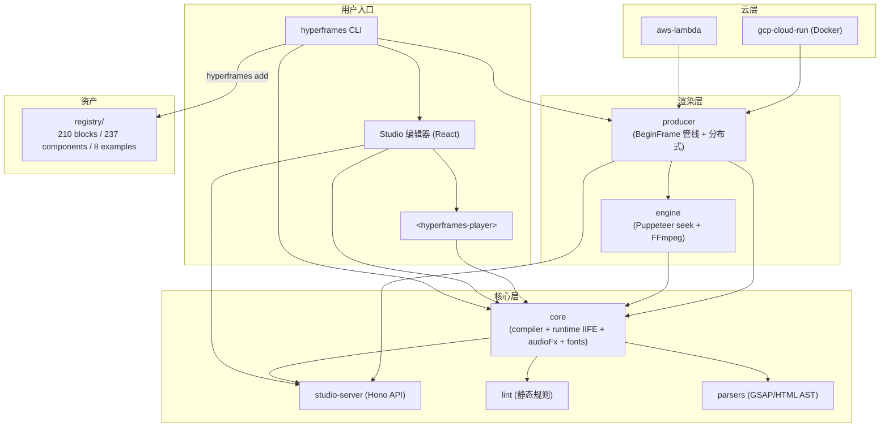
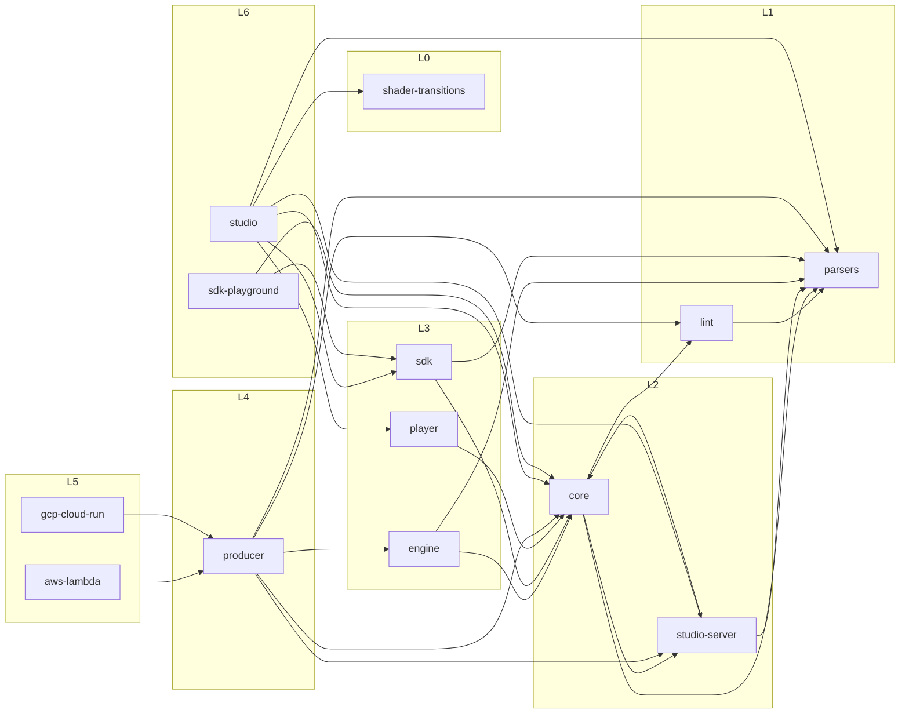

# HyperFrames - 架构分析

> 生成时间: 2026-10-11
> 分析方式: 脚本扫描（project-info / structure-analyzer / dependency-scanner）+ 源码验证（14 个 package.json、registry/ 清单、各包 src/ 顶层结构）

## 1. 项目概览

### 1.1 项目信息

| 项目 | 内容 |
|------|------|
| 名称 | hyperframes（monorepo: `hyperframes-monorepo`） |
| 仓库 | https://github.com/heygen-com/hyperframes |
| 语言 | TypeScript（3213 个 .ts）+ JavaScript（75 个 .js）+ 少量 Python（9 个，辅助脚本） |
| 类型 | 开源视频渲染框架：写 HTML，渲染视频 |
| 包管理器 | bun（workspaces: `packages/*`，禁止 pnpm） |
| 模块系统 | ESM（`"type": "module"`） |
| 版本 | 0.8.147 |
| 测试 | vitest + node:test + bun test（producer 分 unit/integration/regression 多套） |
| 构建 | tsup（各包自建）+ 根级 `bun run --filter` 编排 |
| Lint/格式化 | oxlint + oxfmt（非 eslint/prettier/biome），Lefthook 预提交 |

### 1.2 目录结构

```
hyperframes/
├── packages/               # 14 个工作区包（见 §2.2 包总表）
│   ├── parsers/            # L1  GSAP/HTML/composition 解析与写回
│   ├── lint/               # L1  组合文档静态 lint 规则（含浏览器版）
│   ├── studio-server/      # L2  Studio 的 Hono 后端 API
│   ├── core/               # L2  核心库：compiler/runtime/audioFx/fonts/registry
│   ├── engine/             # L3  可 seek 网页→视频引擎（Puppeteer + FFmpeg）
│   ├── sdk/                # L3  无头组合编辑引擎（session/adapters）
│   ├── player/             # L3  <hyperframes-player> web component
│   ├── producer/           # L4  BeginFrame 渲染管线 + 分布式渲染
│   ├── studio/             # L6  可视化编辑器前端（React 19 + Vite）
│   ├── aws-lambda/         # L5  Lambda 分布式渲染适配器（handler/CDK）
│   ├── gcp-cloud-run/      # L5  Cloud Run + Workflows 适配器（Docker）
│   ├── cli/                # L7  hyperframes CLI（集成顶层，bundle 全部包）
│   └── sdk-playground/     # L6  private SDK 演示站（不发布）
├── registry/
│   ├── blocks/             # 210 个可安装子组合场景（<name>.html + registry-item.json）
│   ├── components/         # 237 个可安装效果/片段（含 demo.html）
│   ├── examples/           # 8 个起步项目模板
│   └── catalog-artifact/   # catalog 语义检索向量数据
├── skills/                 # 21 个 AI agent 技能定义（/hyperframes 路由等）
├── docs/                   # Mintlify 文档站（hyperframes.heygen.com）
├── examples/               # aws-lambda / gcp-cloud-run / k8s-jobs 云部署示例
├── scripts/                # 发布/校验/目录生成等仓库级脚本
└── plans/                  # 设计 spike 脚本
```

## 2. 架构设计

### 2.1 架构模式

**分层 monorepo + 管线架构**。整体是一个严格分层的 bun workspace，层次由根 `package.json` 的 build 脚本顺序固定（`packages/cli` 最后构建）：

1. **解析层**（parsers）— 用 acorn/recast/@babel/parser 把 composition HTML 与其中的 GSAP timeline 语句解析成可操作的 AST，并可写回。
2. **规则层**（lint）— 对组合文档做静态结构检查（复用 parsers）。
3. **核心层**（core）— HTML 文档编译器（`src/compiler/`）、浏览器内执行 runtime（`src/runtime/`，另构建为内联 IIFE `hyperframe.runtime.iife.js` 注入组合）、音频效果链（audioFx*）、确定性字体内嵌（wawoff2 子集化）、registry/storyboard/slideshow 等领域能力。
4. **引擎层**（engine + producer）— engine 提供"可 seek 网页→视频"的捕获能力；producer 在其上实现基于 Chrome BeginFrame API 的完整渲染管线（capture → encode → audio mix）并支持分布式。
5. **消费层**（studio / player / sdk）— Studio 可视化编辑（React 19）、player 可嵌入播放（web component）、sdk 无头编辑（四种宿主适配器：memory/fs/headless/iframe）。
6. **云适配层**（aws-lambda / gcp-cloud-run）— 把 producer 封装成 Serverless 计划分发渲染。
7. **集成层**（cli）— citty 命令框架，把全部能力以 `hyperframes` 命令交付终端用户；对内部包的引用放在 devDependencies 中，构建时打包进 bundle（CLI 不产生运行时 workspace 依赖）。

关键设计决策：

- **HTML 即组合源**：不做私有 DSL，`data-*` 属性 + `class="clip"` 承载时间语义，GSAP 为默认动画运行时（经 frame adapter 可插拔 Lottie/Three.js/Anime.js/CSS/WAAPI）。
- **确定性渲染**：禁 `Date.now()`、无种子 `Math.random()`、渲染期网络抓取 —— 保证逐帧 seek 捕获与实时预览逐像素一致（producer 内置 preview-vs-producer 像素级 parity/regression 测试保障）。
- **循环依赖受控**：`core ↔ studio-server` 存在双向 workspace 依赖（core/src/studio-api re-export studio-server），由根脚本 `check:package-cycles`（scripts/check-package-cycles.mjs）显式监控/豁免。

### 2.2 核心模块

| 模块 | 职责 | 关键文件 |
|------|------|----------|
| @hyperframes/parsers | GSAP timeline 解析/改写/序列化、HTML 解析（linkedom）、ffmpeg 二进制定位 | `packages/parsers/src/gsapParser*.ts`、`gsapWriterAcorn.ts`、`htmlParser.ts`、`composition*.ts`、`ffBinaries.ts` |
| @hyperframes/lint | 组合静态 lint 规则、渲染阻断判定 | `packages/lint/src/hyperframeLinter.ts`、`rules/`、`browser.ts`、`shouldBlockRender.ts` |
| @hyperframes/core | 编译器 + 浏览器 runtime + 音频效果 + 字体 + 调色 | `packages/core/src/compiler/`、`runtime/`、`audio/` + `audioFx*.ts`、`fonts/`、`colorGrading/` |
| @hyperframes/engine | 可 seek 页面→视频捕获引擎（Puppeteer + FFmpeg） | `packages/engine/src/config.ts`、`services/`、`utils/alphaBlit` |
| @hyperframes/producer | BeginFrame 渲染管线、Hono 渲染服务、分布式、回归基线 | `packages/producer/src/server.ts`、`distributed.ts`、`regression-harness*.ts`、`parity-*.ts` |
| @hyperframes/sdk | 无头组合编辑会话（history/persist） | `packages/sdk/src/session.ts`、`adapters/`、`history.ts` |
| @hyperframes/player | 可嵌入播放器 web component | `packages/player/src/hyperframes-player.ts`、`runtime-in-srcdoc.ts`（iframe 沙箱） |
| @hyperframes/studio | 可视化编辑器（React 19 + zustand + CodeMirror + dockview） | `packages/studio/src/App.tsx`、`components/`、`webmcp/` |
| @hyperframes/studio-server | Studio 后端：历史、截图、转码、响度 | `packages/studio-server/src/createStudioApi.ts`、`routes/`、`helpers/` |
| @hyperframes/cli | 用户命令行（init/add/lint/check/snapshot/preview/render/publish/doctor/lambda/catalog/skills） | `packages/cli/src/cli.ts`、`commands/`、`templates/`、`browser/`、`renderSetupWorker*.ts` |
| @hyperframes/aws-lambda | Lambda 分布式渲染（@sparticuz/chromium + ffmpeg-static） | `packages/aws-lambda/src/handler.ts`、`cdk/`、`s3PlanV2Publisher.ts` |
| @hyperframes/gcp-cloud-run | Cloud Run + Workflows 渲染（Docker 镜像交付） | `packages/gcp-cloud-run/src/server.ts`、`terraform.ts`、`gcsPlanV2Publisher.ts` |
| @hyperframes/shader-transitions | WebGL shader 转场自定义元素 | `packages/shader-transitions/src/hyper-shader.ts`、`shaders/` |

### 2.3 架构图



## 3. 依赖关系分析

### 3.1 外部依赖（关键项）

| 依赖 | 用于 | 用途 |
|------|------|------|
| puppeteer / puppeteer-core | engine, producer, gcp-cloud-run | 无头 Chrome CDP 逐帧捕获 |
| @sparticuz/chromium + ffmpeg-static/ffprobe-static | aws-lambda | Lambda 内运行 Chrome 与 ffmpeg |
| hono + @hono/node-server | producer, studio-server, gcp-cloud-run | 渲染服务 / Studio API 的 HTTP 层 |
| acorn / recast / @babel/parser / magic-string | parsers, core | GSAP 语句与 JS 的解析、改写、序列化 |
| linkedom / postcss / wawoff2 | core | 服务端 DOM、CSS 处理、字体内嵌子集化 |
| citty / sharp / fontkit / esbuild / giget | cli | 命令框架、图像/字体处理、模板拉取 |
| react 19 / zustand / codemirror / dockview-react | studio | 编辑器 UI 栈（peer 依赖） |
| gsap | 各处（core devDep，内联进 runtime） | 默认动画运行时 |
| onnxruntime-node + @google/genai | cli (devDep) | whisper 转写 / TTS 推理 |
| html2canvas | shader-transitions | 转场前 DOM 截图 |

### 3.2 模块依赖图（workspace 内部，层次自下而上）



注：`cli`（L7）以 devDependencies 引用全部 9 个 @hyperframes 包，构建时打包进 bundle —— 图中省略。`core ↔ studio-server` 为受控双向边（`check:package-cycles` 监控）。

### 3.3 依赖健康度

- 工作区包：14（其中 1 个 private 不发布）
- 根级开发依赖：17（commitlint、lefthook、oxlint/oxfmt、vitest、knip、esbuild、tsx、typescript、yaml、concurrently、happy-dom、fallow 等）
- 过时依赖：未逐一核查；根 devDependencies 均为较新主版本（React 19 / TS 5 / vitest 4 / oxlint 1.56）
- 结构风险（低）：`core ↔ studio-server` 循环已存在守卫脚本；`parsers → core` 仅测试期 devDep，不构成发布循环

## 4. 设计模式识别

| 模式 | 位置 | 说明 |
|------|------|------|
| 管线（Pipeline） | producer 渲染、core 编译 | capture → encode → audio mix 分阶段编排 |
| 适配器（Adapter） | `packages/sdk/src/adapters/`（memory/fs/headless/iframe）、动画 frame adapter | 宿主环境与动画运行时可插拔 |
| 自定义元素（Web Component） | player、shader-transitions | `<hyperframes-player>`、`<hyper-shader>` |
| 规则引擎 | `packages/lint/src/rules/` | 静态 lint 规则集 + `shouldBlockRender` 门禁 |
| Golden/回归基线 | `parsers/src/__goldens__/`、producer `regression-harness` | 解析器黄金基线 + 渲染像素级 parity |
| 模板/脚手架 | `packages/cli/src/templates/` | `hyperframes init` 项目模板（CLAUDE.md/AGENTS.md 成对） |
| 注册表（Registry） | `registry/` + `core/src/registry/` | 可安装块/组件清单 + 语义检索向量 |
