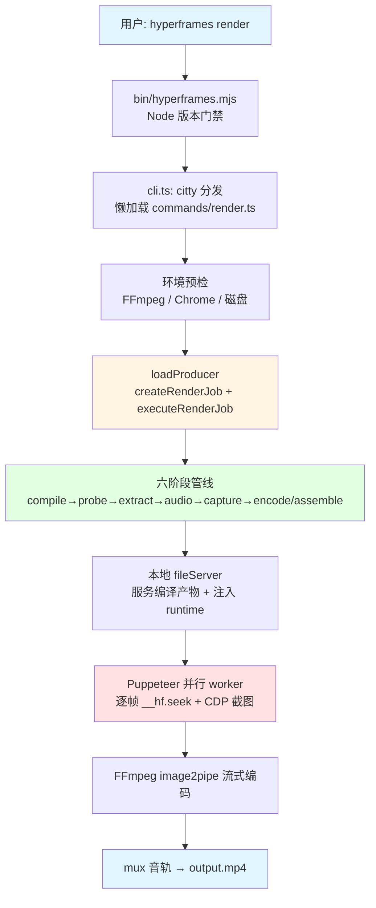
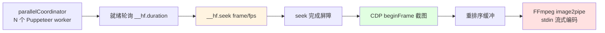
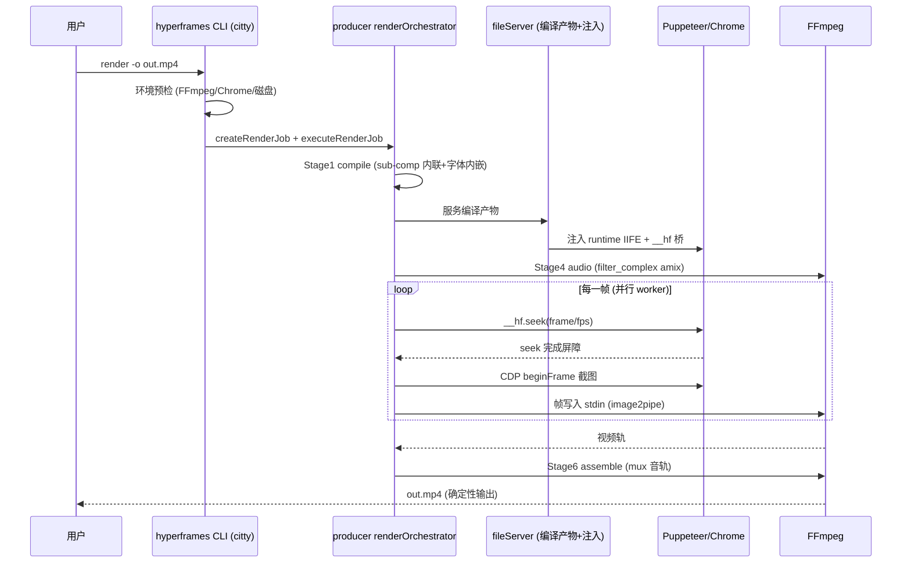
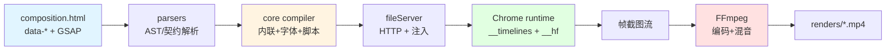
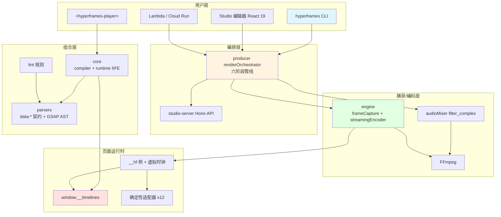

# HyperFrames - 运行机制详解

> 生成时间: 2026-10-11
> 分析方式: runtime-tracer.sh 自动扫描 + 源码全链路追踪（CLI → core 解析 → producer 管线 → engine 捕获/编码 → player 预览）

## 一、项目运行方式

HyperFrames 是"写 HTML，渲染视频"的框架：组合（composition）是带 `data-*` 时间属性的 HTML 文档，渲染时由无头 Chrome 逐帧 seek 截图，交给 FFmpeg 编码混音，产出确定性 MP4。

### 1. 安装与执行

```bash
# 终端用户（无需 bun）
npx hyperframes init my-video && cd my-video
npx hyperframes preview        # 浏览器实时预览
npx hyperframes render         # 渲染 MP4

# 仓库贡献者（bun workspace）
bun install && bun run build && bun run test
```

### 2. 执行流程（render 命令总览）



## 二、核心运行机制

### 2.1 CLI 命令分发

**位置**: `packages/cli/bin/hyperframes.mjs`、`packages/cli/src/cli.ts:80,123-185`

**说明**: bin 入口做 Node 版本门禁后动态 `import("../dist/cli.js")`；主文件用 **citty** 框架，`command` 映射表懒加载约 45 个子命令（init/add/catalog/preview/render/lint/check/snapshot/publish/doctor/skills/lambda/tts/transcribe…），每个命令一个文件（`commands/*.ts`，含同名测试）。启动时还做 EPIPE 抑制、`--version` 快速退出、自动加载 CWD `.env`（cli.ts:13-99）。

### 2.2 组合解析模型（data-* 契约）

**位置**: `packages/parsers/src/compositionContract.ts:4-33,153,361`、`htmlParser.ts:50,181,204`、`types.ts:142,309-315`

**说明**: 静态解析（Node 侧，DOMParser/linkedom）：

- **权威时间属性** `data-start` + `data-duration` + `data-track-index`；`data-end` 为编译器派生；`data-layer` 为 legacy
- `parseStartExpression()` 支持跨 clip 引用表达式（如 `myclip+0.5`）
- `querySelectorAll("[data-start]")` 收集 timed elements，按标签/`data-type` 分类（video/image/audio/text/composition），`assignHfIds` 给每个 clip 铸稳定 `data-hf-id`
- `data-composition-src` 标记 sub-composition 引用；类型系统为 `CompositionSpec` / `TimelineElement` 联合类型 / `Fps` 有理数帧率（NTSC 直通 FFmpeg `-r 30000/1001`）
- **sub-composition 内联**: `packages/core/src/compiler/inlineSubCompositions.ts:315,648` 抓取子 HTML、包装 scoped 脚本、重写资源路径后拍平进宿主
- 内联 GSAP 脚本由 Acorn 解析/回写（`gsapParserAcorn.ts` / `gsapWriterAcorn.ts`）


### 2.3 运行时注入与 `__hf` 桥

**位置**: `packages/producer/src/services/fileServer.ts:612-673`、`packages/core/src/runtime/entry.ts:32`、`runtime/player.ts:114,149,214,247`

**说明**: 页面加载后，框架注入两条脚本：

1. **runtime IIFE**（core 构建的 `hyperframe.runtime.iife.js`，producer 经 SHA-256 manifest 校验加载 `hyperframeRuntimeLoader.ts`）—— 任何作者脚本求值前先建 `window.__timelines = {}` 注册表（entry.ts:32）；作者以 `gsap.timeline({paused:true})` 注册到 `__timelines[compositionId]`
2. **`__hf` 桥**（fileServer 注入）—— 轮询 runtime 暴露的 `window.__player`，把 `renderSeek` 包装为 `__hf.seek(t, options)`，getter `__hf.duration`（含 `__renderReady`/`__hfTimelinesBuilding` 守卫）；同步驱动 `__HF_VIRTUAL_TIME__.seekToTime` 虚拟时钟（覆盖 setInterval/rAF）并递归 seek 同源子 iframe

**机制作用**:

- **接管时间**: 虚拟时钟 + `__timelines` 注册表让"页面在任意时刻 T 的样子"完全可复现
- **媒体所有权**: 框架而非作者脚本驱动 `<video>/<audio>`（脚本里 play/pause/currentTime 被禁止）
- **空注册表即错误**: `frameCapture.ts:1690` 检测；无动画组合须声明 `data-no-timeline` 跳过等待

### 2.4 确定性 seek 与帧适配器

**位置**: `packages/core/src/runtime/player.ts:114`、`runtime/adapters/`（gsap/css/waapi/animejs/lottie/three/typegpu/d3/mapbox…，注册于 `runtime/init.ts:4020-4036`）、`core/src/adapters/gsap.ts:18,37-42`

**说明**: `renderSeek()` 走 `seekMasterAndSiblingTimelinesDeterministically()` —— 时间量化到 canonical fps 后统一 seek master 与 sibling timelines。每种动画运行时一个**确定性适配器**（GSAP 为主，另支持 CSS/WAAPI/Anime.js/Lottie/Three.js/TypeGPU/D3/地图类）。`seek-dispatch.ts` 去重派发 `"hf-seek"` CustomEvent，`waitUntil()` 提供异步完成屏障（`__hfWaitForSeekCompletion`）。Node 侧帧适配器 `createGSAPFrameAdapter()` 暴露 `init/getDurationFrames/seekFrame(frame)`（`seekFrame = timeline.seek(frame/fps, false)`）。

### 2.5 逐帧捕获与流式编码（engine）

**位置**: `packages/engine/src/services/frameCapture.ts`（5083 行）、`screenshotService.ts:151-177`、`parallelCoordinator.ts`、`streamingEncoder.ts:187-193,463`

**说明**: 捕获循环：

1. 就绪轮询 `!!(window.__hf && __hf.seek === "function" && __hf.duration > 0)`（frameCapture.ts:1724）
2. 逐帧 `seekPageTimeline()`（:2827）单次 evaluate 调 `__hf.seek(t)`，返回 composite-pending 标志
3. 截图：CDP `HeadlessExperimental.beginFrame` 单次确定性渲染周期带回截图（jpeg q≈80 / png），fallback `Page.captureScreenshot`
4. **并行**: parallelCoordinator 按 CPU/内存分配多 Puppeteer session，帧乱序产出；streamingEncoder 的帧重排序缓冲保证顺序写入
5. 编码：spawn FFmpeg `-f image2pipe`，帧 buffer 直写 stdin（流式）；或落盘 frames 目录走 chunkEncoder
6. 视频源帧：`videoFrameExtractor.ts` 预抽帧 + `videoFrameInjector.ts` 注入页面（配 `__hfReseekGpu`），避免浏览器解码不确定性



### 2.6 Producer 六阶段渲染管线

**位置**: `packages/producer/src/services/renderOrchestrator.ts:6-21,1414,2768`、`services/render/stages/`

**说明**: `createRenderJob()` + `executeRenderJob()` 编排六个独立阶段模块：

| 阶段 | 模块 | 职责 |
|------|------|------|
| 1 compile | `compileStage.ts:151` | htmlCompiler（core/compiler）：sub-comp 内联 + 字体内嵌 |
| 2 probe | `probeStage.ts` | 探测组合元信息 |
| 3 extract videos | `extractVideosStage.ts` | 视频源抽帧 / HDR 预检 |
| 4 audio | `audioStage.ts:66` | 调 engine `processCompositionAudio()` |
| 5 capture | `captureStage.ts:284`（+ streaming/segmented/HDR 变体） | 逐帧捕获 |
| 6 encode → assemble | `encodeStage.ts:257` → `assembleStage.ts:83` | 编码并 mux 音轨 |

**音频混合**: `packages/engine/src/services/audioMixer.ts:1112` —— FFmpeg `filter_complex`：每轨 `adelay` + `volume`（keyframe 音量包络 `volumeLaneKeyframes:517`、fade `:340`），`amix=inputs=N:duration=longest:dropout_transition=0`（:856）+ 归一化补偿（:1031-1037），支持分组嵌套 amix（对应 `<hf-audio-group>`）。

**CLI → producer 链路**: `commands/render.ts:907` `renderLocal()` → 环境预检 → `loadProducer()`（:1039）→ `createRenderJob`（:1095）→ `executeRenderJob()`（:1106）；Docker 路线 `renderDocker` 固定环境。

### 2.7 Player 预览（web component）

**位置**: `packages/player/src/hyperframes-player.ts:95,1640`、`iframe-dom.ts:171`、`shouldInjectRuntime.ts`、`runtime-message-handler.ts:62`

**说明**: `<hyperframes-player>` 自定义元素内部建 `<iframe>`（`src` 或 `srcdoc` 承载组合 HTML）；每 200ms 探测 —— 有嵌套 sub-comp 立即注入 runtime，自包含的先给 5 tick 适配器宽限期再兜底注入。播放协议走 iframe postMessage（`ready`/`state`/`shader-transition-state`）；无 runtime 时 `timeline-adapters.ts` 直驱 `__timelines` + `direct-timeline-clock.ts` 时钟。Studio 的 live preview 复用同一 iframe 与 `window.__hf.setLoopStart/leasePausedMedia` 控制面（runtime/init.ts:3046-3092）。

### 2.8 lint / check 双层门禁

**位置**: `packages/lint/src/hyperframeLinter.ts` + `rules/`；`packages/cli/src/commands/check.ts:138`、`utils/checkPipeline.ts`、`utils/checkBrowser.ts:187,361-399,527-547`

**说明**:

- **lint（静态）**: 规则组 structure/composition/core/adapters/gsap/media/fonts/captions/linkedClips/slideshow/textures；`shouldBlockRender()` 使 lint 失败阻断 render（producer 管线内 `hyperframeLint.ts` 同样执行）；`sourceLocations.ts` 把 data-* 属性映射回原始文件行列
- **check（运行时，一个浏览器会话）**: 采样时刻合并（layout/caption/contrast/motion，checkPipeline.ts:97-171）→ `runBrowserCheck()` 监听 console/pageerror 收集运行时错误 → 逐时刻 seek 后采集布局/重叠/旋转样本 → WCAG 对比度五帧采样（`selectContrastTimes`）+ motion 断言（`motionAudit.ts`/`motionSpec.ts`）→ CheckReport + 退出码

## 三、完整工作流程

### 场景 1: 本地渲染一条组合

```bash
npx hyperframes init demo && cd demo
# 编辑 index.html（data-* 时间轴 + GSAP paused timeline 注册到 window.__timelines）
npx hyperframes lint && npx hyperframes check   # 双层门禁必须通过
npx hyperframes snapshot --at 0,2,4            # 抽查关键帧
npx hyperframes render -o out.mp4
```

### 场景 2: Studio 可视化编辑

```bash
npx hyperframes preview        # dev 模式 spawn Vite（preview.ts:1519），发布模式走内嵌 server（:1551）
# 浏览器打开 Studio（React 19 + dockview）：
#   studio-server (Hono /api) 提供文件原子写、缩略图、波形、响度、历史、lint、render 队列
```

### 完整工作流序列图



## 四、数据流与状态管理

### 4.1 数据流转



### 4.2 关键数据结构

| 结构 | 用途 | 定义位置 |
|------|------|----------|
| `CompositionSpec` | 组合规格（尺寸/帧率/时长） | `packages/parsers/src/types.ts:309` |
| `TimelineElement` 联合类型 | 各类 clip 的统一时间轴元素 | `packages/parsers/src/types.ts:315` |
| `window.__timelines` | 运行时 GSAP timeline 注册表（按 compositionId） | `packages/core/src/runtime/entry.ts:32` |
| `window.__hf` | producer 注入的 seek 桥（seek/duration） | `packages/producer/src/services/fileServer.ts:637-673` |
| `__HF_VIRTUAL_TIME__` | 虚拟时钟（覆盖 setInterval/rAF） | 同上 |
| Frame Adapter (`init/getDurationFrames/seekFrame`) | Node 侧逐帧驱动契约 | `packages/core/src/adapters/gsap.ts:18` |
| CheckReport | check 门禁的结构化结果 | `packages/cli/src/utils/checkPipeline.ts` |

### 4.3 状态管理

渲染是**无共享状态的作业模型**：`createRenderJob()` 建作业 → `executeRenderJob()` 顺序推进六阶段，阶段间通过 staging 目录（symlink/junction/拷贝降级）与 segment manifest 传递数据；页面侧时间状态完全由虚拟时钟 + seek 决定（无"播放中"概念，任意帧可独立求值）。编辑态（Studio/SDK）则是有状态会话：sdk `session.ts` + `history.ts` + `persist-queue.ts` 管理撤销栈与持久化队列。

## 五、扩展机制

### 5.1 适配器体系（核心扩展点）

| 适配器类型 | 位置 | 可插拔对象 |
|-----------|------|-----------|
| 确定性运行时适配器 | `packages/core/src/runtime/adapters/`（gsap/css/waapi/animejs/lottie/three/typegpu/d3/mapbox/leaflet/google-maps/maplibre） | 动画运行时 |
| Node 帧适配器 | `packages/core/src/adapters/gsap.ts` | 逐帧 seek 驱动 |
| SDK 宿主适配器 | `packages/sdk/src/adapters/`（memory/fs/headless/iframe） | 编辑引擎宿主环境 |
| 云适配器 | `packages/aws-lambda`、`packages/gcp-cloud-run` | 分布式渲染目标（Plan/RenderChunk/Assemble 分块协议） |

### 5.2 钩子点

| 钩子 | 触发时机 | 用途 | 注册位置 |
|------|----------|------|----------|
| `shouldBlockRender()` | render 前 | lint 失败阻断渲染 | `packages/lint/src/project.ts`（index.ts:14 导出） |
| `"hf-seek"` CustomEvent | 每次 seek | 运行时组件感知时间变化 | `packages/core/src/runtime/seek-dispatch.ts` |
| iframe postMessage（ready/state） | player 播放 | 播放器 ↔ 组合通信 | `packages/player/src/runtime-message-handler.ts:62` |
| registry-item.json | `hyperframes add` | 块/组件安装元数据 | `registry/blocks|components/*/` |

### 5.3 配置管理

项目级 `hyperframes.json`（registry URL + paths 安装位置，详见《使用指南》§2）；CLI 自动加载 CWD `.env`（cli.ts:13-99）；环境变量覆盖浏览器发现（`HYPERFRAMES_BROWSER_PATH` 等）。无全局配置文件层级。

## 六、运行时架构总结



## 总结

HyperFrames 的运行机制围绕以下核心概念：

1. **HTML 即时间轴**: `data-start/duration/track-index` 契约 + `class="clip"`，`data-composition-src` 组合子场景，Acorn 解析内联 GSAP
2. **注册表约定**: 作者 timeline 以 `paused:true` 注册到 `window.__timelines[compositionId]`，空注册表即错误
3. **确定性 seek**: `__hf` 桥 + 虚拟时钟 + 量化到 canonical fps 的 master/sibling 统一 seek，12 种运行时确定性适配器
4. **逐帧捕获**: 并行 Puppeteer session 乱序截图 + CDP `beginFrame` 单渲染周期 + 重排序缓冲顺序喂 FFmpeg `image2pipe`
5. **六阶段管线**: compile → probe → extract videos → audio（filter_complex amix）→ capture → encode/assemble，阶段模块独立可测
6. **双层门禁**: lint 静态规则（可阻断 render）+ check 单浏览器会话运行时审计（错误/布局/motion/WCAG 对比度）
7. **一致预览**: player iframe 复用同一 runtime 与 seek 协议，保证"所见即所渲"

这种设计使 HyperFrames 既**以开放 Web 技术（HTML/CSS/JS/GSAP）为创作界面**，又**通过虚拟时钟与确定性捕获达到影视级可复现输出**，非常适合程序化视频生成、AI agent 工作流与 Serverless 大规模分布式渲染。
